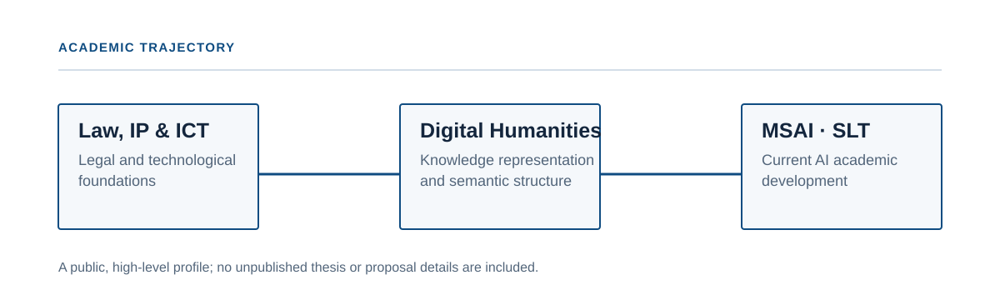
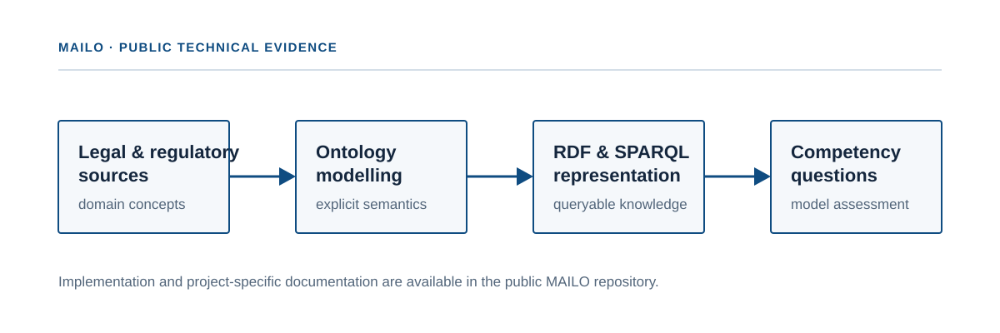

# Chang-Hua Kao (Victor) — Academic Research Portfolio

**Legal knowledge representation · Knowledge graphs · Semantic Web · Reliable AI**

I work at the intersection of law, knowledge representation, and artificial intelligence. My interests concern how legal and regulatory knowledge can be represented, queried, validated, and used responsibly in computational systems.

This is an academic-facing portfolio of public and independently verifiable work. It does not describe unpublished thesis work, unconfirmed research topics, or non-public proposal details.

**Companion presentation site:** [Chang-Hua Kao — Academic Research Portfolio](https://victor-kao-research-portfolio.syrupyowlet8.chatgpt.site)

The presentation site is a concise, public-facing introduction to the same public artifacts. This README remains the canonical portfolio: it carries the fuller project notes, links, technical evidence, and scope statements.

  

## Research interests

- Legal and regulatory knowledge representation
- Ontology engineering, RDF, OWL, SHACL, and SPARQL
- Knowledge graphs and semantic systems
- Reliable AI for legal and regulatory domains
- Language-model-assisted semantic understanding
- Provenance, validation boundaries, and meaningful human review

These are research interests, not claims about unpublished results or ongoing research findings.

## Selected public research artifacts

### [MAILO — Medical AI Legal Ontology](projects/mailo.md)

MAILO is the principal knowledge-representation artifact in this portfolio: an OWL 2 / RDF model of EU regulatory obligations bearing on medical AI. Its public release includes source annotations, SPARQL-accessible knowledge, and SHACL constraints whose validation boundaries are stated explicitly.

**Public evidence:** canonical ontology, 1,946 triples, 65 classes, 82 object/datatype properties, 19 SHACL node shapes, legal-source provenance, persistent namespace, release history, and documentation.

[Repository](https://github.com/vrkkao-eng/Mailo-ontology) · [Documentation](https://vrkkao-eng.github.io/Mailo-ontology/index-en.html) · [SSRN resource paper](https://ssrn.com/abstract=7476078)

  

### [MAILO Legal AI Engine](projects/mailo-legal-ai-engine.md)

A companion Python/FastAPI engineering prototype that connects reviewed regulatory-change data to traceable obligation, control, evidence, human-review, and audit workflows. It keeps the canonical legal ontology separate from application state and avoids treating automated workflow outputs as autonomous legal conclusions.

**Public evidence:** typed APIs, deterministic workflow logic, transactional persistence, idempotency, validation and graph export, reproducible tests, CI, and documented operational boundaries.

[Repository](https://github.com/vrkkao-eng/mailo-legal-ai-engine)

### [Adaptive KG Reasoning](projects/adaptive-kg-reasoning.md)

A research prototype investigating incremental reasoning over dynamic knowledge-graph windows. It compares materialisation and query-time derivation strategies while making correctness, benchmark conditions, cost accounting, and recovery limitations inspectable.

**Public evidence:** OWL-RL baseline, deterministic fixtures, regression tests, reproducible benchmark outputs, manifests, and bounded service/recovery experiments.

[Repository](https://github.com/vrkkao-eng/adaptive-kg-reasoning)

## Earlier legal research

- [Regulation of Foundational Models and Generative AI: Fundamental Right to Data Protection](https://github.com/vrkkao-eng/IpIct_MANAMA_Thesis_AI_Data_protection) — public interactive visualisation of a KU Leuven Advanced Master thesis in IP & ICT Law.
- [On Kelsen's Concept of Authority](https://github.com/vrkkao-eng/Kelsen-authority-visualization) — public bilingual visualisation of earlier jurisprudential research on legal authority.

These works provide legal-theoretical and regulatory foundations; they are not presented as knowledge-graph or NLP projects.

## Academic trajectory

My background spans law, intellectual property and ICT, digital humanities and knowledge representation, and current academic development in artificial intelligence, speech and language technology. This trajectory informs an interest in rigorous and transparent computational approaches to complex legal and regulatory information.

## Portfolio boundaries

The portfolio foregrounds original, public artifacts with documented evidence. It intentionally does not treat learning repositories, third-party source mirrors, general software projects, or unpublished coursework as academic research outputs.

## Links

- [Presentation site](https://victor-kao-research-portfolio.syrupyowlet8.chatgpt.site)
- [GitHub profile](https://github.com/vrkkao-eng)
- [LinkedIn — Victor Chang-Hua Kao](https://www.linkedin.com/in/victor-changhua-kao/)

---

*Public repositories and publications are the source of record for implemented artifacts, claims, and limitations.*